# Modelo de Clases — DermaCare Backend

Sistema de Gestión Dermatológica · Spring Boot 3.2.5 / 4.1.0 · Java 17

---

## Diagrama de Clases

```mermaid
classDiagram
    direction TB

    class UserRole {
        <<enumeration>>
        ADMIN_SECRETARIA
        MEDICA_PRESTADORA
    }

    class AppointmentStatus {
        <<enumeration>>
        AVAILABLE
        PENDING_PAYMENT
        CONFIRMED
        CANCELLED
        COMPLETED
    }

    class PaymentMethod {
        <<enumeration>>
        CASH
        MERCADO_PAGO
        BANK_TRANSFER
    }

    class PaymentStatus {
        <<enumeration>>
        PENDING
        APPROVED
        REJECTED
        REFUNDED
    }

    class Profile {
        <<Entity>>
        +UUID id
        +UserRole role
        +String firstName
        +String lastName
        +LocalDateTime createdAt
        +getId() UUID
        +getRole() UserRole
        +getFirstName() String
        +getLastName() String
    }

    class Patient {
        <<Entity>>
        +Long id
        +String firstName
        +String lastName
        +String dni
        +Integer age
        +String profession
        +String contactPhone
        +String contactEmail
        +String pathologicalHistory
        +String allergies
        +String toxicHabits
        +String sunExposure
        +String spfUse
        +String surgicalHistory
        +String gynecologicalHistory
        +String habitualMedication
        +LocalDateTime createdAt
        +LocalDateTime updatedAt
        +getId() Long
        +getDni() String
    }

    class ServiceEntity {
        <<Entity>>
        +Long id
        +String name
        +String description
        +Integer durationMinutes
        +BigDecimal price
        +Boolean isActive
        +LocalDateTime createdAt
        +getId() Long
        +getName() String
        +getPrice() BigDecimal
    }

    class Appointment {
        <<Entity>>
        +Long id
        +Profile doctor
        +Patient patient
        +ServiceEntity service
        +String timeRange
        +AppointmentStatus status
        +ZonedDateTime lockedUntil
        +String mercadoPagoPreferenceId
        +String mercadoPagoPaymentId
        +LocalDateTime createdAt
        +LocalDateTime updatedAt
        +getId() Long
        +getStatus() AppointmentStatus
    }

    class Payment {
        <<Entity>>
        +Long id
        +Appointment appointment
        +BigDecimal amount
        +PaymentMethod paymentMethod
        +PaymentStatus status
        +String concept
        +LocalDateTime transactionDate
        +String externalReference
        +String recordedBy
        +getId() Long
        +getAmount() BigDecimal
    }

    class CalendarBlock {
        <<Entity>>
        +Long id
        +Profile doctor
        +ZonedDateTime startTime
        +ZonedDateTime endTime
        +String reason
        +String createdBy
        +LocalDateTime createdAt
        +getId() Long
    }

    class Consultation {
        <<Entity>>
        +Long id
        +Appointment appointment
        +String reasonForVisit
        +String fitzpatrickPhototype
        +String facialExam
        +String bodyExam
        +String procedurePerformed
        +String materialsUsed
        +String complicationsObserved
        +Integer patientSatisfactionLevel
        +String notes
        +LocalDateTime createdAt
        +getId() Long
    }

    class PatientRepository {
        <<interface>>
        +findAll() List
        +findById(id) Optional
        +findByDni(dni) Optional
        +existsByDni(dni) boolean
        +save(patient) Patient
        +delete(patient) void
    }

    class AppointmentRepository {
        <<interface>>
        +findAll() List
        +findById(id) Optional
        +save(appointment) Appointment
        +delete(appointment) void
    }

    class PaymentRepository {
        <<interface>>
        +findByAppointmentId(id) List
        +findByStatus(status) List
        +calculateTotalApprovedAmount() BigDecimal
        +calculateTodayApprovedAmount(startOfDay) BigDecimal
    }

    class CalendarBlockRepository {
        <<interface>>
        +findByDoctorId(doctorId) List
        +findOverlappingBlocks(doctorId, start, end) List
    }

    class IAppointmentDao {
        <<interface>>
        +findById(id) Optional
        +findAll() List
        +findByStatus(status) List
        +save(appointment) Appointment
        +delete(appointment) void
    }

    class AppointmentDaoImpl {
        <<DAO>>
        -EntityManager entityManager
        +findById(id) Optional
        +findAll() List
        +findByStatus(status) List
        +save(appointment) Appointment
        +delete(appointment) void
    }

    class CryptoKeyRegistry {
        <<Singleton>>
        -Map keyStore
        +getInstance() CryptoKeyRegistry$
        +getKey(alias) byte[]
        +registerKey(alias, key) void
    }

    class JwtService {
        <<Service>>
        -String secretKey
        -long jwtExpiration
        +extractUsername(token) String
        +extractClaim(token, resolver) Object
        +isTokenValid(token, username) boolean
    }

    class JwtAuthenticationFilter {
        <<Component>>
        -JwtService jwtService
        +doFilterInternal(req, res, chain) void
    }

    class SecurityConfig {
        <<Configuration>>
        -JwtAuthenticationFilter jwtAuthFilter
        +securityFilterChain(http) SecurityFilterChain
    }

    class AuthController {
        <<RestController>>
        -JwtService jwtService
        +login(credentials) ResponseEntity
    }

    class PatientService {
        <<Service>>
        -PatientRepository patientRepository
        +getAllPatients() List
        +getPatientById(id) Optional
        +createPatient(patient) Patient
        +updatePatient(id, updatedData) Patient
        +deletePatient(id) void
    }

    class AppointmentService {
        <<Service>>
        -AppointmentRepository appointmentRepository
        -MercadoPagoService mercadoPagoService
        +getAllAppointments() List
        +getAppointmentById(id) Optional
        +createAppointment(appointment) Appointment
        +hasCollision(appointment) boolean
        +updateStatus(id, newStatus) Appointment
        +cancelAppointment(id) void
        +createPaymentPreference(id, deposit, title, email) PaymentPreferenceResponse
    }

    class PaymentService {
        <<Service>>
        -PaymentRepository paymentRepository
        -AppointmentRepository appointmentRepository
        +registerCashPayment(appointmentId, amount, concept, recordedBy) Payment
        +processMercadoPagoWebhook(payload, eventType, paymentId) boolean
        +getCollectionsSummary() Map
        +getAllPayments() List
    }

    class AppointmentCleanupScheduler {
        <<Component>>
        -AppointmentRepository appointmentRepository
        +releaseExpiredPendingAppointments() void
    }

    class PatientController {
        <<RestController>>
        -PatientService patientService
        +getAllPatients() List
        +getPatientById(id) ResponseEntity
        +createPatient(patient) Patient
        +updatePatient(id, patient) ResponseEntity
        +deletePatient(id) ResponseEntity
    }

    class AppointmentController {
        <<RestController>>
        -AppointmentService appointmentService
        -PaymentService paymentService
        +getAllAppointments() List
        +getAppointmentById(id) ResponseEntity
        +createAppointment(appointment) Appointment
        +updateStatus(id, status) ResponseEntity
        +cancelAppointment(id) ResponseEntity
        +createPaymentPreference(id, request) ResponseEntity
        +registerCashPayment(id, request) ResponseEntity
    }

    class WebhookController {
        <<RestController>>
        -PaymentService paymentService
        +handleMercadoPagoWebhook(type, topic, dataId, id, payload) ResponseEntity
    }

    class AnalyticsController {
        <<RestController>>
        -PaymentService paymentService
        -AppointmentService appointmentService
        +getCollectionsMetrics() ResponseEntity
        +getDashboardMetrics() ResponseEntity
    }

    class GlobalExceptionHandler {
        <<RestControllerAdvice>>
        +handleIllegalArgument(ex) ResponseEntity
        +handleIllegalState(ex) ResponseEntity
    }

    %% Relaciones entre entidades
    Appointment --> Profile : doctor
    Appointment --> Patient : patient
    Appointment --> ServiceEntity : service
    Consultation --> Appointment : appointment
    Payment --> Appointment : appointment
    CalendarBlock --> Profile : doctor
    Profile --> UserRole : role
    Appointment --> AppointmentStatus : status
    Payment --> PaymentMethod : paymentMethod
    Payment --> PaymentStatus : status

    %% DAO Pattern
    AppointmentDaoImpl ..|> IAppointmentDao : implements

    %% Repositorios
    PatientRepository --> Patient : gestiona
    AppointmentRepository --> Appointment : gestiona
    PaymentRepository --> Payment : gestiona
    CalendarBlockRepository --> CalendarBlock : gestiona

    %% Servicios
    PatientService --> PatientRepository : usa
    AppointmentService --> AppointmentRepository : usa
    AppointmentService --> MercadoPagoService : usa
    PaymentService --> PaymentRepository : usa
    PaymentService --> AppointmentRepository : usa
    AppointmentCleanupScheduler --> AppointmentRepository : usa

    %% Controladores
    PatientController --> PatientService : usa
    AppointmentController --> AppointmentService : usa
    AppointmentController --> PaymentService : usa
    WebhookController --> PaymentService : usa
    AnalyticsController --> PaymentService : usa
    AnalyticsController --> AppointmentService : usa
    AuthController --> JwtService : usa

    %% Seguridad
    JwtAuthenticationFilter --> JwtService : usa
    SecurityConfig --> JwtAuthenticationFilter : registra
```



---

## Relaciones entre entidades

| Desde | Tipo | Hasta | Columna FK | Nulable | Propósito |
|-------|------|-------|------------|---------|-----------|
| `Appointment` | `@ManyToOne` | `Profile` | `doctor_id` | No | Profesional asignado |
| `Appointment` | `@ManyToOne` | `Patient` | `patient_id` | Sí | Paciente citado |
| `Appointment` | `@ManyToOne` | `ServiceEntity` | `service_id` | Sí | Tratamiento solicitado |
| `Payment` | `@ManyToOne` | `Appointment` | `appointment_id` | No | Transacción de seña/pago |
| `CalendarBlock`| `@ManyToOne` | `Profile` | `doctor_id` | No | Bloqueo horario de médica |
| `Consultation` | `@OneToOne` | `Appointment` | `appointment_id` | No | Historia clínica del turno |

---

## Estructura de paquetes

```
com.dermacare.backend
├── controllers/
│   ├── AuthController          POST /api/auth/login
│   ├── PatientController       GET /api/patients · POST /api/patients · GET/PUT/DELETE /api/patients/{id}
│   ├── AppointmentController   GET/POST /api/appointments · PATCH status · POST cancel · POST payment-preference · POST payments/cash
│   ├── WebhookController       POST /api/webhooks/mercadopago (Confirmación asíncrona de pagos)
│   ├── AnalyticsController     GET /api/analytics/collections · GET /api/analytics/dashboard
│   └── GlobalExceptionHandler  @RestControllerAdvice (400 Bad Request / 409 Conflict)
├── services/
│   ├── PatientService          Lógica de negocio y validación de pacientes
│   ├── AppointmentService      Lógica de agenda, colisiones horarias y preferencias de pago
│   ├── PaymentService          Transacciones financieras (Efectivo y Mercado Pago) y analítica
│   ├── MercadoPagoService      Integración con la API Checkout Pro de Mercado Pago
│   └── AppointmentCleanupScheduler Tarea programada (@Scheduled) de expiración de bloqueos de 10 min
├── dao/
│   ├── IAppointmentDao         Interfaz formal del patrón DAO
│   └── AppointmentDaoImpl      Implementación canónica con EntityManager
├── entities/
│   ├── Patient                 Entidad paciente
│   ├── Appointment             Entidad turno / cita
│   ├── Payment                 Entidad transaccion_pago (historial multi-intento)
│   ├── CalendarBlock           Entidad bloqueo de agenda (vacaciones/cierre)
│   ├── Consultation            Entidad atención clínica
│   ├── Profile                 Entidad usuario / perfil
│   ├── ServiceEntity           Entidad catálogo de servicio
│   ├── AppointmentStatus       Enum estados de turno
│   ├── PaymentMethod           Enum medios de pago (CASH, MERCADO_PAGO, BANK_TRANSFER)
│   ├── PaymentStatus           Enum estados de pago (PENDING, APPROVED, REJECTED, REFUNDED)
│   └── UserRole                Enum roles (ADMIN_SECRETARIA, MEDICA_PRESTADORA)
├── repositories/
│   ├── PatientRepository       JpaRepository<Patient, Long>
│   ├── AppointmentRepository   JpaRepository<Appointment, Long>
│   ├── PaymentRepository       JpaRepository<Payment, Long>
│   └── CalendarBlockRepository JpaRepository<CalendarBlock, Long>
└── security/
    ├── CryptoKeyRegistry       Singleton Thread-Safe (Bill Pugh Holder Idiom)
    ├── JwtService              Manejo de tokens JWT
    ├── JwtAuthenticationFilter Filtro HTTP (OncePerRequestFilter)
    └── SecurityConfig          Configuración de seguridad Spring y CORS
```
